# Cahier des Charges Technique & Fonctionnel
## Projet : Extracteur Réseau Local (Npcap) & Synchroniseur Temps Réel Hôtel des Ventes Albion Online vers Google Sheets

**Statut du document** : Version Finale — Prêt pour chiffrage et développement  
**Rôle rédacteur** : Architecte Full-Stack & Ingénieur Data  
**Cible** : Développeur Expert C# / .NET  
**Classeur Google Sheets cible** : [**calcul auto cape** (`1FJoZCCUAXzYW5iyS4nQ_JRKgToXtS5X3FhQhu5ylLkE` — Onglet `gid=565413548`)](https://docs.google.com/spreadsheets/d/1FJoZCCUAXzYW5iyS4nQ_JRKgToXtS5X3FhQhu5ylLkE/edit?gid=565413548#gid=565413548)

---

## 1. Contexte, Vision et Objectifs du Projet

### 1.1 Problématique métier
Le classeur Google Sheets **« calcul auto cape »** du client est un outil d'aide à la décision et de calcul de rentabilité d'artisanat (*crafting*) sur **Albion Online** (Capes de villes/factions, Sacs, Vestes en cuir, Robes en tissu, Armures de plates). Il s'articule autour de 3 onglets :
1. **`Indice prix` (`gid=565413548`)** : Onglet d'entrée regroupant les prix unitaires de toutes les matières premières (Cuir, Tissu, Planches, Barres de fer de `T2` à `T8.4`), les Armoiries de capes (`T4` à `T8`), les Cœurs de faction, l'Énergie avalonienne, le Feu de fée, le Tome de perspicacité, les Sceaux royaux et les Artefacts (`T4` à `T8`).
2. **`Cout de craft` (`gid=2132110722`)** : Onglet 100 % automatisé par formules qui calcule le coût de fabrication de chaque équipement à partir des valeurs de `'Indice prix'`.
3. **`Sélection` (`gid=0`)** : Tableau de bord final où le coût de craft est comparé au **`Prix de vente`** pour calculer automatiquement le bénéfice unitaire et le bénéfice total.

Or, la saisie manuelle des prix est chronophage, et les API publiques tierces (comme l'*Albion Online Data Project - AODP*) présentent trois défauts majeurs :
* **Obsolescence des données** : Prix souvent vieux de plusieurs heures.
* **Manipulation des données (*Data Poisoning*)** : Valeurs falsifiées envoyées par des tiers sur les serveurs communautaires.
* **Dépendance externe** : Risque de coupure ou de limitation de débit.

### 1.2 Objectif de la solution commandée
Développer un **client logiciel interne, autonome et 100 % local** sous Windows qui :
1. **Capture passivement** les paquets réseau UDP d'Albion Online via le pilote **Npcap** lorsque l'utilisateur consulte l'Hôtel des Ventes en jeu.
2. **Décode en interne** (sans aucune API externe) les trames du moteur réseau **Exit Games Photon** pour en extraire les offres de vente (*Sell Orders*) et les ordres d'achat (*Buy Orders*).
3. **Associe et filtre** chaque prix extrait selon l'objet (`ItemID`), le Tier, l'Enchantement (`.0` à `.4`), la Qualité (`1` à `5`) et la Ville active.
4. **Injecte automatiquement** ces valeurs aux **coordonnées cellulaires exactes** de la feuille Google Sheets du client (`Indice prix` `gid=565413548` et `Sélection` `gid=0`), permettant aux formules déjà en place de calculer automatiquement les coûts et les prix/marges de vente.

> [!IMPORTANT]
> **Contrainte d'Architecture Souveraine (« Zéro API Tiers Métier »)**  
> L'intégralité de la chaîne d'acquisition — de la capture réseau Npcap jusqu'au décodage binaire Photon et à la traduction des identifiants d'objets — doit s'exécuter **100 % en local sur la machine du client**. Le seul flux réseau sortant autorisé est l'appel HTTPS authentifié vers l'API officielle **Google Sheets API v4** (`sheets.googleapis.com`).

---

## 2. Cadre Légal, Sécurité et Conformité (Conditions d'Utilisation du Jeu)

Le développeur devra respecter scrupuleusement la politique officielle de **Sandbox Interactive GmbH** (éditeur d'Albion Online) concernant les outils tiers :

* **Écoute réseau strictement passive (*Passive Packet Sniffing*)** : Sandbox Interactive autorise la lecture passive du trafic réseau non chiffré reçu par le client de jeu tant que l'outil se limite à lire les informations affichées à l'écran (comme l'Hôtel des Ventes) et n'interagit pas avec le client ([Déclaration officielle de Sandbox Interactive — Forum Officiel Albion Online](https://forum.albiononline.com/index.php/Thread/51604-Is-it-allowed-to-scan-your-internet-for-albion-packages/)).
* **Interdictions absolues** :
  * Aucune lecture de la mémoire vive (`ReadProcessMemory`) du processus `Albion-Online.exe`.
  * Aucune injection de DLL, modification de fichiers du jeu ou interception active (*Man-in-the-Middle* / proxy modifiant les paquets).
  * Aucune automatisation de clics, de déplacements ou de saisie clavier (*pas de botting*).
  * Aucune interaction avec le composant anti-triche **BattlEye** / **EasyAntiCheat**.

---

## 3. Architecture Technique Globale

```mermaid
flowchart LR
    subgraph Poste_Client ["Poste Client Windows (100% Interne / Local)"]
        direction TB
        NIC["Carte Réseau (NIC)<br/>Flux UDP Port 5056 / 5055"] --> NPCAP["Driver Npcap<br/>(Filtre BPF Kernel)"]
        NPCAP --> FRAG["Réassembleur IP/UDP<br/>& Fragments Photon"]
        FRAG --> PHOTON["Décodeur Binaire Interne<br/>Photon Protocol16"]
        DUMPS[("Référentiel Local Embarqué<br/>cell_mapping.json + items.json")] --> PARSER["Moteur Métier & Normalisation<br/>(Prix / 10000, Ville, Qualité)"]
        PHOTON --> PARSER
        PARSER --> CACHE[("Cache Local SQLite<br/>Déduplication des prix")]
        CACHE --> BATCH["Gestionnaire de File (Debounce)<br/>Agrégation par lot (2,5 sec)"]
    end

    subgraph Cloud_Google ["Google Sheets ('calcul auto cape')"]
        GS_API["Google Sheets API v4<br/>(values.batchUpdate)"]
        TAB1["Onglet 'Indice prix' (gid=565413548)<br/>Ressources, Armoiries, Cœurs, Artefacts"]
        TAB2["Onglet 'Cout de craft' (gid=2132110722)<br/>Recalcul Automatique (Formules)"]
        TAB3["Onglet 'Sélection' (gid=0)<br/>Injection 'Prix de vente' & Calcul Bénéfice"]
        GS_API --> TAB1
        GS_API --> TAB3
        TAB1 --> TAB2 --> TAB3
    end

    BATCH -- "HTTPS / TLS 1.3 (OAuth2 Service Account)" --> GS_API
```



---

## 4. Stack Technologique Imposée (C# / .NET)

Afin de garantir une compatibilité native avec Windows et avec le moteur réseau d'Albion Online (lui-même développé sous **Unity / C#** et **Exit Games Photon**), la stack technologique suivante est **imposée** au développeur :

| Composant | Technologie Imposée (Stack C# / .NET) | Justification & Sources |
| :--- | :--- | :--- |
| **Runtime & Langage** | **C# 12 / .NET 8 LTS (ou .NET 9)** sous Windows x64 | Le client Albion Online étant codé en C# (Unity), les structures de données et types de sérialisation correspondent nativement au protocole Photon. |
| **Capture Réseau (Npcap)** | [`SharpPcap`](https://github.com/dotpcap/sharppcap) (v6.3+) + [`PacketDotNet`](https://github.com/dotpcap/packetdotnet) | Encapsulation officielle C# de l'API `wpcap.dll` de Npcap avec filtrage BPF au niveau noyau Windows (NDIS 6), sans perte de paquets lors d'un défilement rapide. |
| **Décodage Photon** | Module interne C# `PhotonPackageParser` (basé sur **Protocol16**) | Décodage 100 % local des trames `OperationRequest`, `OperationResponse` et `EventData` sans dépendance externe (architecture éprouvée par [`AlbionOnline-StatisticsAnalysisTool`](https://github.com/Triky313/AlbionOnline-StatisticsAnalysisTool)). |
| **Stockage & Cache Local** | **SQLite** (`Microsoft.Data.Sqlite`) | Mémorise localement le dernier prix envoyé par cellule afin de ne solliciter l'API Google Sheets que si le prix a réellement varié. |
| **Client Google Sheets** | [`Google.Apis.Sheets.v4`](https://www.nuget.org/packages/Google.Apis.Sheets.v4) (SDK Officiel Google .NET) | Support natif des *Service Accounts*, gestion automatique des jetons d'authentification et des écritures groupées via `batchUpdate`. |
| **Interface Utilisateur (UI)** | **WPF / WinUI 3** (avec réduction en barre des tâches *System Tray*) | Permet à l'utilisateur de visualiser en temps réel l'état de la capture Npcap, la ville active et le journal des synchronisations Google Sheets. |

---

## 5. Spécifications Fonctionnelles et Techniques par Module

### Module 1 : Capture Réseau Bas Niveau (Npcap)

1. **Vérification de l'environnement au démarrage** :
   * Détecter la présence du driver **Npcap** (`C:\Windows\System32\Npcap\wpcap.dll`).
   * Si absent, afficher une alerte claire invitant à installer Npcap.
2. **Sélection automatique des interfaces réseau** :
   * Écouter automatiquement l'interface réseau active recevant le trafic d'Albion Online (compatible Ethernet, Wi-Fi et VPN de jeu type ExitLag).
3. **Filtrage BPF au niveau Kernel** :
   * Appliquer le filtre suivant directement au niveau du driver Npcap pour ignorer tout le reste du trafic Internet du PC et garantir une consommation CPU inférieure à 1 % :
     ```text
     udp and (port 5056 or port 5055 or port 4535)
     ```
   * Supporter les 3 serveurs officiels d'Albion Online (*Albion Europe*, *Albion Americas*, *Albion Asia*).

---

### Module 2 : Désérialisation du Protocole Photon (100 % Interne)

1. **Réassemblage des paquets fragmentés (`SendReliableFragment`)** :
   * Lorsqu'une page de 50 offres est affichée à l'Hôtel des Ventes, le message dépasse la taille maximale d'un paquet UDP (1500 octets) et arrive découpé en plusieurs fragments Photon (commande de type `8`).
   * Le logiciel doit impérativement réassembler ces fragments en mémoire avant d'en extraire les données du marché.
2. **Opérations Métier à Intercepter** :
   * **`Join` / `ChangeCluster`** : Détecte automatiquement la ville dans laquelle se trouve le joueur (`Lymhurst`, `Bridgewatch`, `Martlock`, `Thetford`, `Fort Sterling`, `Caerleon`, `Black Market`, `Brecilien`).
   * **`AuctionGetOffers`** : Extrait la liste des offres de vente affichées à l'écran (Identifiant de l'objet, Tier, Enchantement, Qualité, Quantité disponible et Prix unitaire).
   * **`AuctionGetRequests`** : Extrait la liste des ordres d'achat affichés à l'écran.
3. **Maintenabilité après les patchs du jeu (`opcodes.json`)** :
   * À chaque mise à jour majeure d'Albion Online, les numéros d'opérations (`OperationCodes`) peuvent changer. Ces identifiants ne doivent pas être figés dans le code compilé mais lus depuis un fichier externe `opcodes.json` facilement éditable.
4. **Règle de conversion monétaire d'Albion** :
   * Dans les paquets réseau d'Albion Online, les prix sont multipliés par un facteur interne de $10\,000$. Le logiciel doit diviser chaque valeur brute par $10\,000$ pour obtenir le prix réel en Silver :
     $$\text{Prix Réel (Silver)} = \frac{\text{UnitPriceSilver}_{\text{brut}}}{10\,000}$$
5. **Référentiel Local des Objets (`items.json`)** :
   * Embarquer localement le dictionnaire officiel des objets d'Albion (issu de `ao-bin-dumps`) pour traduire les identifiants techniques (`T4_LEATHER`, `T6_CAPEITEM_FW_LYMHURST_BP`, etc.) sans aucun appel Internet externe.

---

### Module 3 : Cartographie Cellulaire Exacte du Classeur « calcul auto cape »

L'application doit écrire les valeurs extraites aux emplacements exacts suivants du classeur `1FJoZCCUAXzYW5iyS4nQ_JRKgToXtS5X3FhQhu5ylLkE` (ces règles sont également pré-configurées dans le fichier [cell_mapping.json](file:///c:/Users/romai/Desktop/projet%20richesse/cell_mapping.json)).

#### 3.1 Onglet Cible n°1 : `'Indice prix'` (`gid=565413548`) — Matériaux & Composants

##### Bloc A — Ressources Raffinées (`Plage B6:E32`)
Les lignes sont indexées par la colonne `A` (`2`, `3`, puis `4.0` à `8.4`) et les colonnes par le type de ressource en ligne `5` :

| Colonne | En-tête (`Ligne 5`) | Identifiant Albion (`ItemTypeId`) | Plage Exacte | Formule de calcul de la ligne ($T \in [4..8], E \in [0..4]$) |
| :---: | :--- | :--- | :---: | :--- |
| **`B`** | `Cuir ` | `T{T}_LEATHER` (ou `_LEVEL{E}@{E}`) | `'Indice prix'!B6:B32` | $T=2 \rightarrow \text{Ligne } 6$<br/>$T=3 \rightarrow \text{Ligne } 7$<br/>$T \ge 4 \rightarrow \text{Ligne } = 8 + (T - 4) \times 5 + E$ |
| **`C`** | `Tissu` | `T{T}_CLOTH` (ou `_LEVEL{E}@{E}`) | `'Indice prix'!C6:C32` | Identique (`C6` pour `T2` jusqu'à `C32` pour `T8.4`) |
| **`D`** | `Planche` | `T{T}_PLANKS` (ou `_LEVEL{E}@{E}`) | `'Indice prix'!D6:D32` | Identique (`D6` à `D32`) |
| **`E`** | `Barre de fer ` | `T{T}_METALBAR` (ou `_LEVEL{E}@{E}`) | `'Indice prix'!E6:E32` | Identique (`E6` à `E32`) |

##### Bloc B — Armoiries de Capes (`Plage I5:V9`)
Les lignes correspondent au Tier (`Ligne 5` = `T4`, `Ligne 6` = `T5`, `Ligne 7` = `T6`, `Ligne 8` = `T7`, `Ligne 9` = `T8`, soit $\text{Ligne} = T + 1$) :

| Colonne | En-tête (`Ligne 4`) | Identifiant Albion (`ItemTypeId` pour $T \in [4..8]$) | Plage Cellulaire |
| :---: | :--- | :--- | :---: |
| **`I`** | `Lym` | `T{T}_CAPEITEM_FW_LYMHURST_BP` | `'Indice prix'!I5:I9` |
| **`J`** | `Bridge` | `T{T}_CAPEITEM_FW_BRIDGEWATCH_BP` | `'Indice prix'!J5:J9` |
| **`K`** | `martlock ` | `T{T}_CAPEITEM_FW_MARTLOCK_BP` | `'Indice prix'!K5:K9` |
| **`L`** | `thetford` | `T{T}_CAPEITEM_FW_THETFORD_BP` | `'Indice prix'!L5:L9` |
| **`M`** | `fort sterling ` | `T{T}_CAPEITEM_FW_FORTSTERLING_BP` | `'Indice prix'!M5:M9` |
| **`N`** | `caerleon ` | `T{T}_CAPEITEM_FW_CAERLEON_BP` | `'Indice prix'!N5:N9` |
| **`O`** | `hérétique ` | `T{T}_CAPEITEM_HERETIC_BP` | `'Indice prix'!O5:O9` |
| **`P`** | ` démoniaque ` | `T{T}_CAPEITEM_DEMON_BP` | `'Indice prix'!P5:P9` |
| **`Q`** | `guardien` | `T{T}_CAPEITEM_KEEPER_BP` | `'Indice prix'!Q5:Q9` |
| **`R`** | `morgana` | `T{T}_CAPEITEM_MORGANA_BP` | `'Indice prix'!R5:R9` |
| **`S`** | `morts vivants ` | `T{T}_CAPEITEM_UNDEAD_BP` | `'Indice prix'!S5:S9` |
| **`T`** | `Contrebandier` | `T{T}_CAPEITEM_SMUGGLER_BP` | `'Indice prix'!T5:T9` |
| **`U`** | `ava` | `T{T}_CAPEITEM_AVALON_BP` | `'Indice prix'!U5:U9` |
| **`V`** | `Brécilien ` | `T{T}_CAPEITEM_FW_BRECILIEN_BP` | `'Indice prix'!V5:V9` |

##### Bloc C — Cœurs de Faction, Énergie Avalonienne, Feu de Fée, Tome & Sceaux Royaux
| Cellule Exacte | Libellé dans la feuille | Identifiant Albion (`ItemTypeId`) |
| :---: | :--- | :--- |
| **`'Indice prix'!H13`** | `fauvecoeur` | `T1_FACTION_STEPPE_TOKEN_1` |
| **`'Indice prix'!I13`** | `sylvecoeur` | `T1_FACTION_FOREST_TOKEN_1` |
| **`'Indice prix'!J13`** | `rochecoeur` | `T1_FACTION_HIGHLAND_TOKEN_1` |
| **`'Indice prix'!K13`** | `vignecoeur` | `T1_FACTION_SWAMP_TOKEN_1` |
| **`'Indice prix'!L13`** | `cimecoeur` | `T1_FACTION_MOUNTAIN_TOKEN_1` |
| **`'Indice prix'!M13`** | `ombrecoeur` | `T1_FACTION_CAERLEON_TOKEN_1` |
| **`'Indice prix'!N13`** | `énergie ava` | `QUESTITEM_TOKEN_AVALON` |
| **`'Indice prix'!O13`** | `Feu de fée` | `QUESTITEM_TOKEN_MISTS` |
| **`'Indice prix'!H16`** | `Tome de Perspicacité` | `T4_SKILLBOOK_STANDARD` |
| **`'Indice prix'!K16:O16`** | `sceaux royaux` (`t4` à `t8`) | `QUESTITEM_TOKEN_ROYAL_T4` à `T8` |

> [!CAUTION]
> **Cellules Protégées en Colonne `I` (`'Indice prix'!I21:I41`)** :  
> Dans `'Indice prix'`, les plages `I21:I25`, `I29:I33` et `I37:I41` (colonne `royal` des trois tables d'artefacts) contiennent les formules `=K16` à `=O16`. Le logiciel ne doit **jamais** écrire dans la colonne `I` des lignes 21 à 41 : la mise à jour de `K16:O16` répercute automatiquement les prix des sceaux royaux.

##### Blocs D, E, F — Artefacts de Vestes, Robes et Armures (`T4` à `T8`)
1. **Artefacts de Veste en Cuir (`Plage J21:N25`, $\text{Ligne} = 17 + T$)** :
   * `J21:J25` (`traqueur`) : `T{T}_ARTEFACT_ARMOR_LEATHER_MORGANA`
   * `K21:K25` (`tourmenteur`) : `T{T}_ARTEFACT_ARMOR_LEATHER_HELL`
   * `L21:L25` (`spectre`) : `T{T}_ARTEFACT_ARMOR_LEATHER_UNDEAD`
   * `M21:M25` (`marcheurs des brumes`) : `T{T}_ARTEFACT_ARMOR_LEATHER_FEY`
   * `N21:N25` (`ténacité`) : `T{T}_ARTEFACT_ARMOR_LEATHER_AVALON`
2. **Artefacts de Robe en Tissu (`Plage J29:N33`, $\text{Ligne} = 25 + T$)** :
   * `J29:J33` (`druide`) : `T{T}_ARTEFACT_ARMOR_CLOTH_KEEPER`
   * `K29:K33` (`monstre`) : `T{T}_ARTEFACT_ARMOR_CLOTH_HELL`
   * `L29:L33` (`culte`) : `T{T}_ARTEFACT_ARMOR_CLOTH_MORGANA`
   * `M29:M33` (`féerique`) : `T{T}_ARTEFACT_ARMOR_CLOTH_FEY`
   * `N29:N33` (`pureté`) : `T{T}_ARTEFACT_ARMOR_CLOTH_AVALON`
3. **Artefacts d'Armure de Plates (`Plage J37:N41`, $\text{Ligne} = 33 + T$)** :
   * `J37:J41` (`gardetombe`) : `T{T}_ARTEFACT_ARMOR_PLATE_UNDEAD`
   * `K37:K41` (`démon`) : `T{T}_ARTEFACT_ARMOR_PLATE_HELL`
   * `L37:L41` (`judicateur`) : `T{T}_ARTEFACT_ARMOR_PLATE_KEEPER`
   * `M37:M41` (`crépusculaire`) : `T{T}_ARTEFACT_ARMOR_PLATE_FEY`
   * `N37:N41` (`bravoure`) : `T{T}_ARTEFACT_ARMOR_PLATE_AVALON`

---

#### 3.2 Onglet Cible n°2 : `'Sélection'` (`gid=0`) — Prix de Vente des Équipements Finis

Dans l'onglet **`Sélection` (`gid=0`)**, le logiciel lit les lignes d'équipements renseignées par l'utilisateur `(Nom, Tier, Enchantement)` et injecte le prix de vente constaté à l'Hôtel des Ventes uniquement dans la colonne **`Prix de vente`** :

| Sous-Tableau dans `'Sélection'` | Colonnes Clés `(Objet, Tier, Enchant)` | Colonne `Cout de craft` *(Formule — Protégée)* | Colonne Cible **`Prix de vente`** *(Écriture Autorisée)* | Colonnes Bénéfice *(Formules — Protégées)* |
| :--- | :---: | :---: | :---: | :---: |
| **1. Capes** (`Lignes 4 à 24`) | `A4:C24` | `D4:D24` | **`'Sélection'!F4:F24`** | `G4:H24` (`=F4-D4`, `=G4*E4`) |
| **2. Sacs** (`Lignes 29 à 36`) | `A29:C36` | `D29:D36` | **`'Sélection'!F29:F36`** | `G29:H36` (`=F29-D29`, `=G29*E29`) |
| **3. Vestes — Tableau 1** (`Lignes 4 à 18`) | `J4:L18` | `M4:M18` | **`'Sélection'!O4:O18`** | `P4:Q18` (`=O4-M4`, `=P4*N4`) |
| **4. Vestes — Tableau 2** (`Lignes 4 à 18`) | `T4:V18` | `W4:W18` | **`'Sélection'!Y4:Y18`** | `Z4:AA18` (`=Y4-W4`) |
| **5. Robes** (`Lignes 23 à 36`) | `J23:L36` | `M23:M36` | **`'Sélection'!O23:O36`** | `P23:Q36` (`=O23-M23`, `=P23*N23`) |
| **6. Armures** (`Lignes 40 à 54`) | `J40:L54` | `M40:M54` | **`'Sélection'!O40:O54`** | `P40:Q54` (`=O40-M40`, `=P40*N40`) |

---

### Module 4 : Synchronisation Google Sheets API v4 & Gestion des Quotas

1. **Authentification Sécurisée (Service Account)** :
   * Connexion via un compte de service Google Cloud (`service-account.json` stocké localement) disposant du droit **Éditeur** sur le classeur `1FJoZCCUAXzYW5iyS4nQ_JRKgToXtS5X3FhQhu5ylLkE`.
2. **Regroupement des requêtes (*Batching & Debouncing*)** :
   * L'API Google Sheets limite les écritures à **60 requêtes par minute** ([Documentation Officielle des Quotas Google Sheets](https://developers.google.com/sheets/api/limits)).
   * Pour éviter tout blocage (`HTTP 429`) lorsque le joueur parcourt rapidement plusieurs pages de l'Hôtel des Ventes, le logiciel doit accumuler les prix détectés pendant une fenêtre de **2,5 secondes** et les envoyer en **une seule requête groupée** via `spreadsheets.values.batchUpdate`.
   * Si le prix d'un objet n'a pas changé par rapport au cache local SQLite, aucun appel réseau n'est déclenché.

---

## 6. Interface Utilisateur (UX) & Fonctionnalités Attendues

L'application proposera une interface claire et légère affichant :
1. **Voyant d'état Npcap & Réseau** :
   * 🟢 *Connecté au flux Albion Online*
   * 🟡 *En attente de trafic Albion Online (Port UDP 5056)*
   * 🔴 *Pilote Npcap manquant ou erreur d'accès*
2. **Sélecteur de Ville Active** : Détection automatique de la ville courante + liste déroulante permettant de la choisir manuellement si le logiciel est lancé alors que le personnage est déjà dans l'Hôtel des Ventes.
3. **Choix de la règle de prix** : Option permettant d'injecter soit le *Prix de vente minimum (`MIN Sell Order`)*, soit la *Moyenne pondérée des X premières unités*.
4. **Journal d'activité en direct (*Live Logs*)** : Affiche chaque objet détecté en jeu, son prix en Silver et la cellule exacte mise à jour dans Google Sheets.

---

## 7. Livrables & Critères de Validation (Recette Client)

### 7.1 Livrables attendus
1. **Code source C# (.NET 8/9) complet, documenté et versionné (Git)**.
2. **Exécutable Windows autonome (`.exe` 64-bits)** prêt à l'emploi.
3. **Fichiers de configuration externes éditables** :
   * `config.json` (Identifiant du Google Sheet, délai de synchronisation, chemin de la clé Google).
   * `opcodes.json` (Codes d'opérations Photon modifiables sans recompiler lors des patchs du jeu).
   * `cell_mapping.json` (Règles de correspondance cellulaire vers `'Indice prix'` et `'Sélection'`).
   * `items.json` (Dictionnaire local des objets d'Albion).
4. **Guide d'installation rapide (1 page)** (Installation de Npcap + partage du Google Sheet avec le compte de service).

### 7.2 Critères d'acceptation
| ID Test | Scénario de validation | Résultat attendu |
| :--- | :--- | :--- |
| **T-01** | **Autonomie 100 % Interne** | Aucun appel vers une API tierce d'Albion : tout le décodage Npcap/Photon s'exécute localement. |
| **T-02** | **Défilement rapide en jeu** | Parcours rapide de 10 pages consécutives à l'Hôtel des Ventes (500 offres) sans perte de paquets ni dépassement du quota Google Sheets. |
| **T-03** | **Exactitude des prix** | Les montants injectés dans `'Indice prix'` et `'Sélection'` correspondent exactement aux prix affichés en jeu (division par $10\,000$ appliquée). |
| **T-04** | **Protection des formules** | Aucune cellule contenant une formule (`=`) dans `'Indice prix'`, `'Cout de craft'` ou `'Sélection'` n'est écrasée ; les calculs de coûts et de bénéfices se mettent à jour instantanément. |

---

## 8. Sources et Références Techniques (Pour le Développeur)

1. **Npcap SDK & Guide d'Architecture Windows (NDIS 6)** :  
   [https://npcap.com/guide/](https://npcap.com/guide/)
2. **Bibliothèque C# de capture réseau SharpPcap & PacketDotNet** :  
   [https://github.com/dotpcap/sharppcap](https://github.com/dotpcap/sharppcap)
3. **Implémentation de référence du parseur Photon16 en C# (.NET) pour Albion Online** :  
   [https://github.com/Triky313/AlbionOnline-StatisticsAnalysisTool](https://github.com/Triky313/AlbionOnline-StatisticsAnalysisTool)
4. **Référentiel Officiel des Dumps Binaires Albion (`items.json`, `world.json`)** :  
   [https://github.com/ao-data/ao-bin-dumps](https://github.com/ao-data/ao-bin-dumps)
5. **Documentation Google Sheets API v4 (.NET SDK & `values.batchUpdate`)** :  
   [https://developers.google.com/sheets/api/reference/rest/v4/spreadsheets.values/batchUpdate](https://developers.google.com/sheets/api/reference/rest/v4/spreadsheets.values/batchUpdate)
6. **Documentation Google Sheets API v4 — Quotas & Limites de requêtes** :  
   [https://developers.google.com/sheets/api/limits](https://developers.google.com/sheets/api/limits)
7. **Déclaration officielle de Sandbox Interactive sur l'analyse passive de paquets réseau** :  
   [https://forum.albiononline.com/index.php/Thread/51604-Is-it-allowed-to-scan-your-internet-for-albion-packages/](https://forum.albiononline.com/index.php/Thread/51604-Is-it-allowed-to-scan-your-internet-for-albion-packages/)
